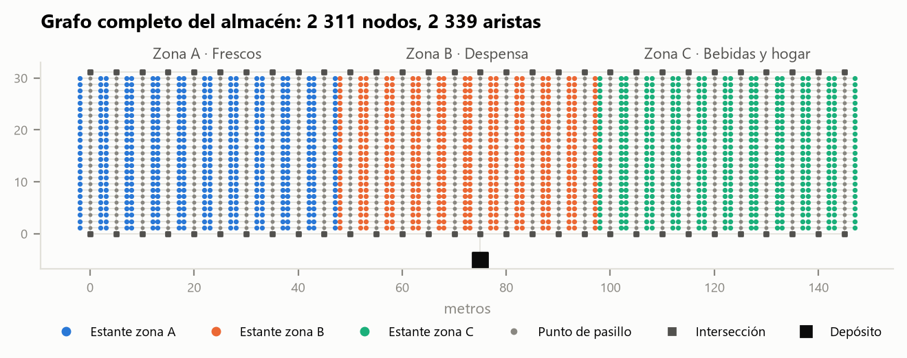

# SmartPick

Optimización de rutas de *picking* en almacenes inteligentes mediante grafos.

Trabajo del curso **1ACC0184 Complejidad Algorítmica (2026-20)**, Grupo 2, Caso de
estudio 2: *Gestión de almacenes inteligentes*.

| Integrante | Código | GitHub | Zona |
| --- | --- | --- | --- |
| Palma de los Santos, Elynor Mikela | U20241A972 | @elynorpalma | A · Frescos |
| Flores Pinchi, José Fernando | U20241A290 | @Ferdinant12-ops | B · Despensa |
| Julca Cruz, Renso Anthony | U202121579 | @rajc02 | C · Bebidas y hogar |



## Qué hace

1. Toma productos y pedidos **reales** del dataset público de Instacart.
2. Guarda los 1 500 productos más pedidos en un almacén de 3 zonas y 30 pasillos.
3. Modela el almacén como un grafo de **2 311 nodos y 2 339 aristas** (estantes,
   pasillos, intersecciones y depósito), con pesos en metros, guardado como lista de
   adyacencia. BFS verifica que es conexo.
4. Calcula la ruta de picking de cada pedido: Dijkstra para las distancias entre
   productos; Held-Karp, backtracking con poda y vecino más cercano para el orden de
   visita. El recorrido en "S" y el orden del carrito sirven de referencia.
5. Muestra la ruta en una interfaz gráfica (Tkinter) y compara las técnicas.

Todos los algoritmos están implementados a mano: no se usa ninguna librería de grafos.

## Instalación

Python 3.12 o superior. Desde la carpeta del proyecto, en la terminal de VS Code:

```
python -m venv .venv
.venv\Scripts\pip install -r requirements.txt
git config core.hooksPath .githooks
```

Solo se instalan `pandas` (lectura del dataset y tablas de resultados) y `matplotlib`
(figuras). Tkinter viene con Python. La última línea activa el control de mensajes de
commit (ver [CONTRIBUTING.md](CONTRIBUTING.md)).

## Uso

| Para | Comando | Escribe en |
| --- | --- | --- |
| Abrir la aplicación: rutas, y pestañas con el grafo y los resultados | `.venv\Scripts\python src/gui.py` | |
| Comparar las técnicas (≈ 40 s) | `.venv\Scripts\python src/experimentos.py` | `figuras/resultados/` |
| Figuras del grafo y del dataset | `.venv\Scripts\python src/visualizar.py` | `figuras/visualizacion/` |
| Diagramas del diseño del aplicativo | `.venv\Scripts\python src/diagramas.py` | `figuras/diseno/` |
| Regenerar el grafo | `.venv\Scripts\python src/grafo.py` | `data/processed/` |
| Regenerar productos y pedidos | `.venv\Scripts\python src/dataset.py` | `data/processed/` |

Los datos procesados ya están en `data/processed/`. Solo `dataset.py` necesita los CSV
originales de Instacart (ver [data/raw/README.md](data/raw/README.md)).

## Estructura

```
smartpick/
├── data/
│   ├── raw/                CSV originales de Instacart (no se suben)
│   └── processed/          productos, pedidos, nodos y aristas del almacén
├── src/
│   ├── config.py           parámetros del almacén y de los algoritmos
│   ├── dataset.py          Instacart -> productos.csv y pedidos.csv
│   ├── grafo.py            productos -> grafo (lista de adyacencia), carga y BFS
│   ├── algoritmos/
│   │   ├── dijkstra.py             distancias entre puntos del almacén (voraz)
│   │   ├── held_karp.py            orden óptimo (programación dinámica)
│   │   ├── backtracking.py         orden óptimo con poda
│   │   ├── vecino_mas_cercano.py   orden aproximado (voraz)
│   │   ├── recorrido_s.py          método de referencia
│   │   └── __init__.py             resolver(): corre las técnicas sobre un pedido
│   ├── gui.py              interfaz gráfica: rutas, grafo y resultados
│   ├── experimentos.py     evaluación de las técnicas con pedidos reales
│   ├── visualizar.py       figuras y tablas del grafo y del dataset
│   ├── diagramas.py        arquitectura, flujo y boceto de la interfaz
│   └── estilo.py           colores y funciones de dibujo comunes
├── figuras/
│   ├── visualizacion/      grafo, subgrafos por integrante, demanda, pedidos
│   ├── diseno/             diagramas del aplicativo (Hito 2)
│   └── resultados/         comparación de técnicas
└── docs/CONTEXTO.md        entregas, rúbrica, modelo, técnicas y resultados
```

## Datos

Instacart. (2017). *The Instacart Online Grocery Shopping Dataset 2017* [Data set].
Kaggle. <https://www.kaggle.com/datasets/psparks/instacart-market-basket-analysis>
